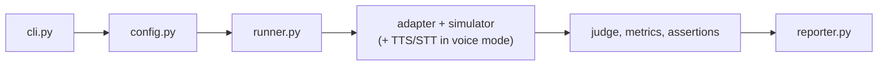

<!-- SPDX-License-Identifier: AGPL-3.0-only -->
# Architecture

This page describes how the Impulse package is organised and how a run flows through it, for contributors and for anyone extending it.

## Quick version

- Impulse is one Python package, `impulse_evals`, with a command line (`impulse`) on top.
- A run flows through a few modules in a fixed order:



- Results are plain files under `.impulse/runs/<run_id>/`: `run.json`, `scenarios/<name>.json`, and `report.html`. There is no database, server, or dashboard.
- To extend Impulse, write an adapter against the Apache-2.0 plugin API ([Adapters](adapters.md#writing-your-own-adapter)).

Words used on this page: TTS is text-to-speech, and STT is speech-to-text.

## Details

### Package layout

```text
impulse_evals/
  __init__.py
  __main__.py         # python -m impulse_evals: the same CLI, run as a module
  cli.py              # the command line (typer)
  config.py           # load and validate config.yaml and .impulse/config.toml; model and key resolution; redaction
  models.py           # the pydantic data models; re-exports the plugin types
  plugin_types.py     # Apache-2.0: AgentTool, ToolCall, MetricContext, MetricResult, ScoreResult
  domains.py          # domain keyword lists and the domain defaults table
  runner.py           # orchestrates a run (text and voice mode)
  simulator.py        # the simulated caller and the system prompt summary
  generator.py        # impulse generate and the domain guard
  transcriber.py      # format_transcript(), load_transcript()
  tool_results.py     # infers a tool call's success from common result shapes
  provider_errors.py  # one-line texts for LLM provider errors
  cohort.py           # language / accent cohorts
  regression.py       # impulse convert-failure
  calibration.py      # impulse calibrate: agreement rate, Cohen's kappa
  compare.py          # impulse compare: diff two runs
  testing.py          # pytest helpers: impulse_check, assert_no_critical
  reporter.py         # JSON and the self-contained HTML reports
  adapters/
    base.py           # Apache-2.0: AgentInterface, AgentReply, AgentClosed
    generic_adapter.py
    custom_adapter.py       # adapter: custom, your own AgentInterface class named in config.yaml
    http_adapter.py         # adapter: http, any agent behind JSON endpoints
    livekit_adapter.py      # extra "livekit"
    pipecat_adapter.py      # extra "pipecat": eval and websocket modes
    _clock.py               # the clock shared by the LiveKit and Pipecat adapters
    _v2_platforms/          # vapi.py, retell.py, bland.py: stubs that raise NotImplementedError
  judge/
    base.py           # Apache-2.0: Judge, JudgeVerdict
    litellm_judge.py  # the LiteLLM judge: routing, tolerant JSON parsing, warnings
    prompts.py        # the safety floor and the judge messages
  metrics/
    base.py           # Apache-2.0: Metric, JudgeMetric, the registry, select_metrics, build_criterion
    universal.py      # UNIV-001 ... UNIV-025
    voice.py          # VOICE-001 ... VOICE-039
    chat.py           # CHAT-001, CHAT-003, CHAT-005
  assertions/
    base.py           # Apache-2.0: Assertion, the lazy pack registry
    dpdp.py rbi_kyc.py trai_dlt.py hipaa.py   # Elastic-2.0 compliance packs
  voice/
    tts.py stt.py     # provider interfaces and factories
    local_hf.py       # in-process Hugging Face speech models (extra "local")
    local_light.py    # in-process Kokoro ONNX TTS and faster-whisper STT, no PyTorch (extra "light")
    openai_compatible.py
    impulse_hosted.py
    litellm_voice.py  # provider litellm: speech through LiteLLM
    audio_utils.py    # WAV read and write (standard library), resampling, stereo mix
    noise.py          # noise simulation (experimental): background noise mixed at a target SNR
  templates/
    report_template.html
    free_config.yaml  # the starter config of impulse init --profile free
```

### How a run flows

1. **`cli.py`** reads `.impulse/config.toml`. Then `config.py` loads and validates `config.yaml` into a `ProjectConfig`. Nothing heavy is imported yet.
2. **`runner.run(config, dry_run=..., concurrency=..., adapter_factory=...)`** prepares the run, before any LLM call:
   - it resolves the three model roles and their keys;
   - it builds the judge (`LiteLLMJudge`) and the simulator;
   - in voice mode, it builds the TTS and STT providers and checks every scenario language against them.
3. **Per scenario**, at most `concurrency` at a time (always one for Pipecat):
   - a new adapter from the factory, then `start(scenario)`;
   - the conversation loop with the simulator;
   - `close()`, then the adapter's metadata and warnings.
4. **Evaluation.** `select_metrics` lists the metric IDs: the scenario's list, plus UNIV-025 and VOICE-011 when they apply. Each metric and each assertion runs with the shared judge. Code-decided skips make no judge call.
5. **Assembly** into a `RunResult`: pass or fail per scenario (`compute_passed`), cohorts, the metric summary, the latency profile, and the deduplicated run warnings.
6. **Output.** The CLI (or `impulse_check`) writes `run.json`, `scenarios/<name>.json`, and `report.html` with `reporter.py`.
   - The CLI then applies `--fail-on`; `impulse_check` does not.
   - `runner.run` itself writes nothing, except the voice-mode audio files, which are written as turns happen.

### Design rules that shape the code

- **The system prompt is the rubric.** The judge is generic: there is no domain-specific logic in it. Domain knowledge comes from your agent's system prompt, plus the fixed safety floor in `judge/prompts.py`.
- **Normative texts are copied, not paraphrased.** The judge prompts and the metric and compliance criteria are copied word for word. They come from the spec and [METRICS.md](../METRICS.md).
- **Lazy imports.** `import impulse_evals` needs none of the extras.
  - pydub, faster-whisper, transformers, kokoro-onnx (with its onnxruntime), `livekit`, and `pipecat-ai` are imported only inside the code that uses them.
  - A compliance pack module is imported only when a scenario lists one of its rules. The registries load metric and pack modules by name.
- **Testable seams.** The Pipecat adapter talks to a small `Channel` interface, and the LiveKit adapter to a `Room` interface. Both have an injectable clock.
  - So the protocol logic is tested with scripted fakes, without a network and without the SDKs installed.
  - The real channels and the real room hold all SDK code.
- **Pipecat is a client, never in-process.** Eval mode reuses Pipecat's own client classes (`EvalClientTransport`, `EvalClientSerializer`) in a small pipeline owned by Impulse. The user's pipeline is never imported or run by Impulse.
- **No hardcoded model names.** Source code never contains a model version string. Models come from `config.yaml`, the environment, or `config.toml`, and templates use `YOUR_..._MODEL` placeholders.
- **Plain files only.** Results are JSON and HTML files under `.impulse/`. There is no database, server, or dashboard.
- **Zero network in tests.** The test suite mocks LiteLLM, the voice servers, the Pipecat channel, and the LiveKit room.

### Licensing by file

| part | files | licence |
|---|---|---|
| core | everything not listed below, including `docs/`, `examples/`, and `tests/` | AGPL-3.0-only |
| plugin API | `plugin_types.py` and the four `base.py` files of `adapters/`, `assertions/`, `judge/`, `metrics/` | Apache-2.0 |
| compliance packs | `assertions/dpdp.py`, `rbi_kyc.py`, `trai_dlt.py`, `hipaa.py` | Elastic License 2.0 |

Every source file starts with its SPDX licence header. See [LICENSING.md](../LICENSING.md) and [Contributing](contributing.md).

#### The plugin API import rule

The Apache-2.0 plugin API files import only each other, the Python standard library, and third-party packages. So extending Impulse through them needs no AGPL code.

- Core names, such as `Scenario` from `impulse_evals.models`, appear only inside `if TYPE_CHECKING:` blocks.
- `TYPE_CHECKING` is `False` when the program runs, so Python skips those imports. Only type checkers read them, for the type annotations.
- For example, `adapters/base.py` imports `ToolCall` from `plugin_types.py` at runtime, and `Scenario` for annotations only.

### Extension points

- **Adapters:** subclass `AgentInterface`. Then name it in `config.yaml` with `adapter: custom`, or pass a factory to `runner.run(config, adapter_factory=...)` ([Adapters](adapters.md#writing-your-own-adapter)).
- **Judges:** `judge/base.py` defines the `Judge` interface (`evaluate(transcript, criterion, tier) -> JudgeVerdict`). The runner uses `LiteLLMJudge`, so any model LiteLLM supports works without new code.
- **Metrics and compliance rules:** the `Metric` and `Assertion` base classes and their registries are in the plugin API. But `config.yaml` accepts only the IDs defined in METRICS.md, which is frozen for 0.1.0. New metrics and rules are added to Impulse itself ([Contributing](contributing.md)).
- **Voice providers:** `openai_compatible` covers any server with the OpenAI audio API shape, local or paid.

### Internals

Implementation details that user-facing pages only point to.

#### Key file permissions

How `impulse init` keeps `.impulse/config.toml` private:

- It writes `.impulse/.gitignore` first, then the key file.
- A new `config.toml` is created with mode 0600 (`os.open(..., 0o600)`): readable and writable by its owner only.
- On Linux and macOS, an overwritten file that was readable by others is narrowed to 0600 (`os.fchmod`) before any new key is written. The mode is set to 0600 again after writing.
- The POSIX checks are tests that run on Linux and macOS only.
- On Windows the mode only controls the read-only flag. The file gets the folder's default permissions.

#### Redaction rules

The rules behind [Privacy and security](privacy-and-security.md#redaction):

- **Minimum lengths.**
  - A value found only by its variable's name ending (`_API_KEY`) counts when it has at least 12 characters. So a placeholder such as `MAPS_API_KEY=book` does not hide the word "book".
  - The same holds for `_SECRET_KEY` and `_JWT` in a dry run (below).
  - Every variable named explicitly counts from 4 characters.
- **Resolved keys.** The keys resolved for the run, or by `impulse doctor` / `impulse init`, count whatever their variable's name.
- **Dry runs** resolve no key. A dry run knows every variable whose name ends in `_API_KEY`, `_SECRET_KEY` or `_JWT`, and the key variables Impulse's own tables name, such as `SNOWFLAKE_JWT`.
- **Masked and encoded forms** of a known key are replaced too:
  - the form providers print in errors, such as `sk-test-************cdef`: a start of the key, three or more `*`, an end of the key;
  - the URL-encoded form;
  - the key inside base64 text. In `Basic base64(user:key)` the key part is replaced, and the user part is kept.
- **Model options.** Every text value of `judge.primary_options`, `judge.fast_options`, `simulator.options`, and `[model_options.<role>]` (with `extra_params`, `extra_headers`, `extra_body`) counts as a secret, except:
  - `model` and `api_key_env`;
  - the provider settings `custom_llm_provider`, `api_version`, `region_name`, `aws_region_name`, `vertex_project`, `vertex_location`, which are not secrets;
  - `api_base`, of which only its credentials count.
- **Commands that know `.impulse/config.toml`** redact the `[model_options.<role>]` values. That includes `impulse generate`, `impulse convert-failure`, `impulse calibrate`, and `impulse doctor` without a `config.yaml`.
- **Pipecat headers:** every `pipecat.headers` value except `Origin`. For `Bearer <token>` only the token is replaced.
- **URLs** (`pipecat.url`, `livekit.url`, the voice `base_url` values):
  - the password of a `user:password@`;
  - a user name without a password, as in `wss://TOKEN@host`, which is the credential itself (a user name next to a password is not redacted);
  - the `token` / `key` / `api_key` / `api-key` / `access_token` query values.
- A `user:password@` in a voice `base_url` is still sent, as Basic auth.

#### LiteLLM's cost map at start-up

- LiteLLM fetches its public model cost map when it is imported, unless the environment variable `LITELLM_LOCAL_MODEL_COST_MAP` is `True`.
- The `impulse` CLI sets it to `True` when it starts, only when you have not set it yourself. LiteLLM then uses the cost map bundled with it.
- The test suite verifies that importing the CLI, then LiteLLM, opens no connection.
- Code that imports Impulse without the CLI does not set the variable.

#### tiktoken's cl100k_base file

- LiteLLM counts tokens with tiktoken and ships the `cl100k_base` file with its package.
- Some LiteLLM wheels (seen on a fresh Windows install) hold that file with Windows (CRLF) line endings.
- tiktoken then rejects it and downloads it once from `openaipublic.blob.core.windows.net`. That happens even for a local `ollama/` model.
- Offline, the call fails with an error that looks like an Ollama failure.
- The repair: unless you have set `CUSTOM_TIKTOKEN_CACHE_DIR`, the `impulse` CLI checks LiteLLM's bundled files when it starts, without importing LiteLLM.
  - If one has CRLF line endings, it writes a repaired copy (line endings fixed, nothing else changed) under your system temp folder in `impulse-tiktoken/`.
  - It sets `CUSTOM_TIKTOKEN_CACHE_DIR` to that folder, so no download is needed.
- A `CUSTOM_TIKTOKEN_CACHE_DIR` you set is never changed. When the repair cannot be written, LiteLLM behaves as before.
- `TIKTOKEN_CACHE_DIR` alone has no effect under LiteLLM, which sets it when it is imported. So it does not turn the repair off, and Impulse never writes into the folder it names. To use your own folder, set `CUSTOM_TIKTOKEN_CACHE_DIR`.
- If the download still fails, `impulse doctor` and `impulse init` add a note naming the tiktoken download to the failed row.

## Next steps

- [Concepts](concepts.md): the ideas behind the components.
- [Adapters](adapters.md): the adapter interface in detail.
- [Contributing](contributing.md): set up a development environment.
- [Privacy and security](privacy-and-security.md): what each component sends where.

---

<!-- docs-nav -->
[← Previous: Privacy and security](privacy-and-security.md) | [Docs home](index.md) | [Next: Contributing →](contributing.md)
